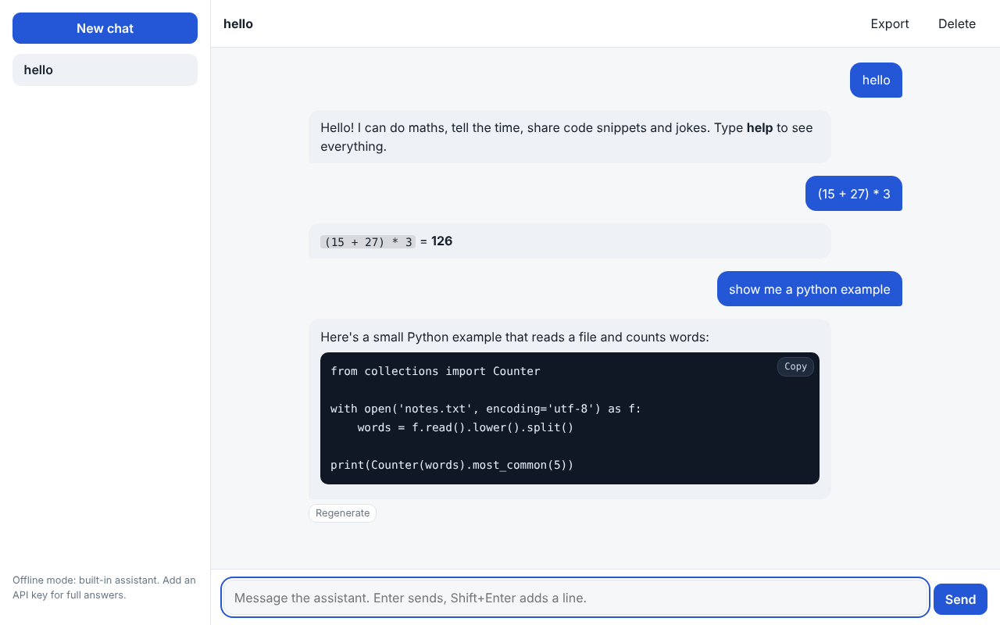

# AI Assistant Interface

A chat interface with a small Flask backend. It works immediately in **offline mode** with a built-in assistant, and switches to a real AI model when you add an API key. The key stays on the server and is never sent to the browser.



## Features
- Multiple saved conversations (kept in the browser), rename-by-first-message, delete, and export to Markdown
- Markdown rendering with code blocks and a copy button; all text is escaped first, so pasted HTML cannot run
- Typing indicator, Regenerate on the last reply, clear error messages when the server or API fails
- Enter to send, Shift+Enter for a new line, auto-growing input
- Light and dark mode, responsive layout with a slide-out chat list on phones

## Offline mode
Without a key, the assistant can do arithmetic (`(15 + 27) * 3`, `2^10`), tell the date and time, share code snippets and jokes, and answer `help`. Maths is evaluated with a restricted parser, so it cannot run code. It cannot answer general questions; that needs an AI model.

## Run it
```bash
git clone https://github.com/ayusman8260/ai-assistant-interface.git
cd ai-assistant-interface
python -m venv .venv && source .venv/bin/activate   # Windows: .venv\Scripts\activate
pip install -r requirements.txt
python server.py
```
Open http://127.0.0.1:5001.

## Connect a real model
Set your key before starting the server (see `.env.example`):
```bash
export ANTHROPIC_API_KEY="your-key"        # Windows PowerShell: $env:ANTHROPIC_API_KEY="your-key"
export ANTHROPIC_MODEL="claude-sonnet-4-6" # optional, change to any model you have access to
python server.py
```
The API call is in `call_anthropic()` in `server.py`. It was tested with the API mocked, not against the live service, so check your key and model name if you see an error.

## Run the tests
```bash
python -m unittest discover -s tests -t .
```

## Project structure
| File | Purpose |
|---|---|
| `server.py` | Flask app, request validation, API call |
| `assistant.py` | Offline assistant |
| `static/` | Chat UI (HTML, CSS, JavaScript) |

## Author
Ayusman Sarangi: [github.com/ayusman8260](https://github.com/ayusman8260)
